#  СРО: Деплой веб-сайта - Docker, Cloudflare Tunnel и AWS S3

Учебный проект: один и тот же статический сайт разворачивается тремя способами.

| № | Способ | Где работает | Адрес |
|---|--------|--------------|-------|
| 1 | **Docker + Nginx** | локально (Kali Linux) | `http://localhost` |
| 2 | **Cloudflare Quick Tunnel** | локальный сервер → интернет | `https://<случайное-имя>.trycloudflare.com` |
| 3 | **AWS S3 Static Website Hosting** | облако AWS (регион Sydney) | `http://sro-my-cool-website-2026.s3-website-ap-southeast-2.amazonaws.com` |

> ⚠️ Ссылки из таблицы уже не работают: туннель закрыт (Ctrl + C), а бакет S3 удалён после сдачи, чтобы AWS не выставил счёт. Подтверждения — на скриншотах ниже.

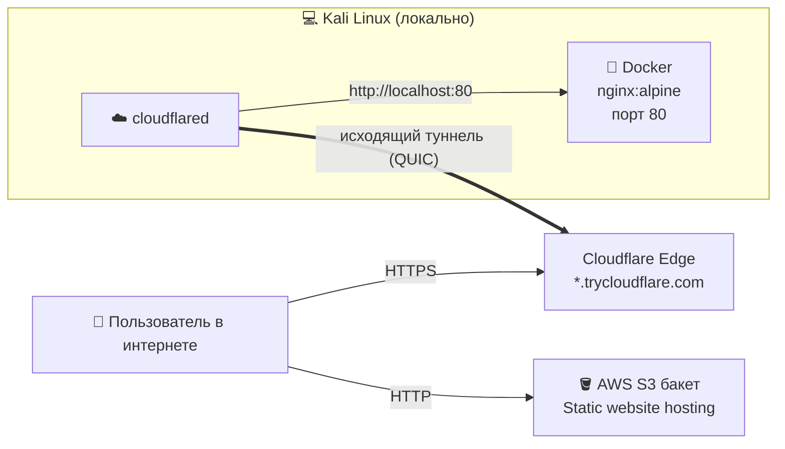

---

## 📁 Структура репозитория

```
sro-web-deploy/
├── docker/
│   ├── index.html            # сайт для Docker / Cloudflare (тёмная тема)
│   └── docker-compose.yml    # альтернатива команде docker run
├── aws/
│   ├── index.html            # сайт для AWS S3 (светлая тема)
│   └── bucket-policy.json    # политика публичного чтения бакета
├── scripts/
│   ├── run-local.sh          # поднять сайт в Docker
│   ├── cloudflare-tunnel.sh  # открыть сайт в интернет через Cloudflare
│   ├── aws-deploy.sh         # деплой в S3 через AWS CLI
│   └── aws-cleanup.sh        # удалить бакет
├── screenshots/              # скриншоты выполнения
└── README.md
```

---

## 1️⃣ Локальный запуск в Docker

### Шаги

```bash
mkdir ~/sro_web && cd ~/sro_web          # папка проекта
nano index.html                          # создаём страницу (см. docker/index.html)

docker run -d --name sro-nginx -p 80:80 -v $(pwd):/usr/share/nginx/html:ro nginx:alpine

docker ps                                # проверяем, что контейнер запущен
curl http://localhost                    # проверяем, что сайт отдаётся
```

### Разбор команды `docker run`

| Часть | Что делает |
|-------|-----------|
| `docker run` | создаёт и запускает новый контейнер |
| `-d` | *detached* — контейнер работает в фоне, терминал свободен |
| `--name sro-nginx` | даёт контейнеру понятное имя (вместо случайного) |
| `-p 80:80` | пробрасывает порт: **порт хоста 80 → порт контейнера 80** |
| `-v $(pwd):/usr/share/nginx/html:ro` | монтирует текущую папку внутрь контейнера туда, откуда Nginx отдаёт файлы. `$(pwd)` — путь к текущей папке, `:ro` — только чтение (контейнер не может изменить файлы) |
| `nginx:alpine` | образ: веб-сервер Nginx на лёгком Linux Alpine (~20 МБ). Если образа нет локально, Docker сам скачивает его с Docker Hub (`Unable to find image ... Pulling from library/nginx`) |

Благодаря `-v` можно править `index.html` на хосте — изменения видны сразу после обновления страницы, без пересборки.

### Другие полезные команды

| Команда | Назначение |
|---------|-----------|
| `docker ps` | список запущенных контейнеров (ID, образ, статус, порты, имя) |
| `docker logs sro-nginx` | логи Nginx (кто и что запрашивал) |
| `docker stop sro-nginx` | остановить контейнер |
| `docker rm sro-nginx` | удалить контейнер |
| `docker compose up -d` | то же самое через `docker/docker-compose.yml` |

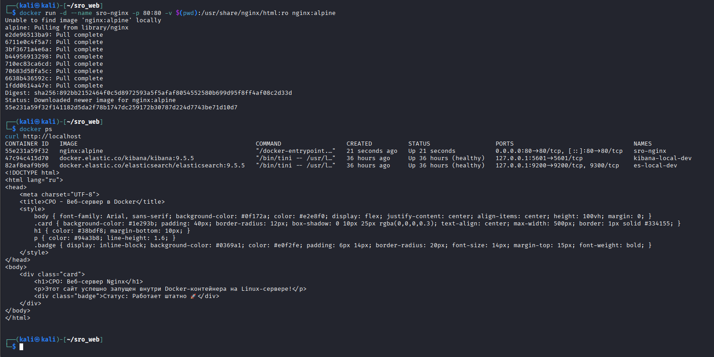

---

## 2️⃣ Публикация в интернет через Cloudflare Tunnel

Сайт в Docker виден только на этом компьютере. **Cloudflare Quick Tunnel** даёт ему временный публичный HTTPS-адрес — без регистрации, без белого IP и без открытия портов на роутере.

### Шаги

```bash
# скачать утилиту cloudflared и сделать её исполняемой
wget https://github.com/cloudflare/cloudflared/releases/latest/download/cloudflared-linux-amd64 -O cloudflared
chmod +x cloudflared

# создать туннель к локальному сайту
./cloudflared tunnel --url http://localhost:80
```

### Разбор

| Часть | Что делает |
|-------|-----------|
| `wget ... -O cloudflared` | скачивает бинарник cloudflared для Linux x64 и сохраняет под именем `cloudflared` |
| `chmod +x` | даёт файлу право на выполнение |
| `./cloudflared tunnel` | запускает клиент туннеля |
| `--url http://localhost:80` | куда пересылать входящий трафик — на наш Nginx в Docker |

### Как это работает

1. `cloudflared` сам устанавливает **исходящее** соединение с сервером Cloudflare (протокол QUIC), поэтому входящие порты открывать не нужно.
2. Cloudflare выдаёт случайный адрес — в моём случае `https://train-pic-characters-shell.trycloudflare.com`.
3. Запрос пользователя → Cloudflare → по туннелю → `localhost:80` → Nginx в Docker.
4. Блок **CONNECTIVITY PRE-CHECKS** в логе: DNS, UDP (QUIC), TCP (HTTP/2) и API Cloudflare — все `PASS`.
5. **Ctrl + C** в терминале — туннель закрывается, сайт пропадает из интернета.

Предупреждение `failed to sufficiently increase receive buffer size` — не ошибка, а совет увеличить UDP-буфер; на работу туннеля не влияет.

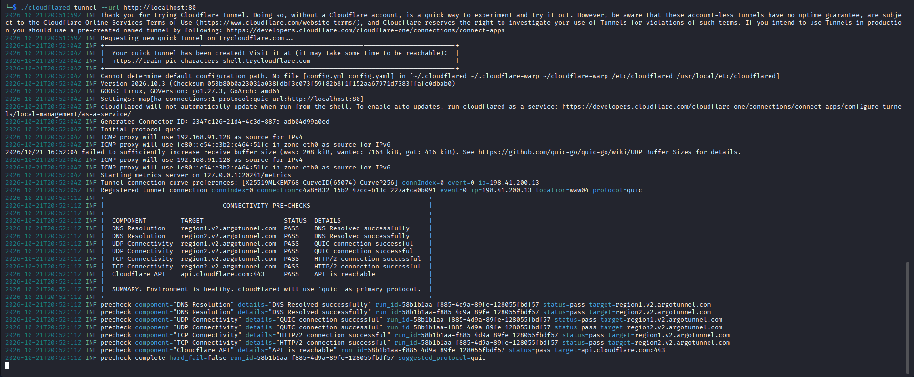

Сайт открывается по публичной ссылке и с Windows-хоста, и из Kali:

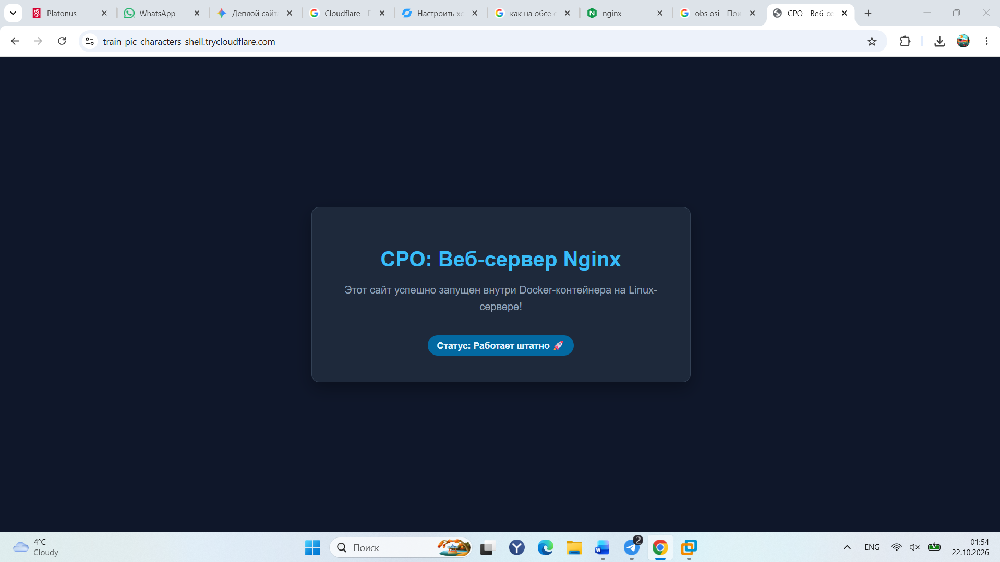
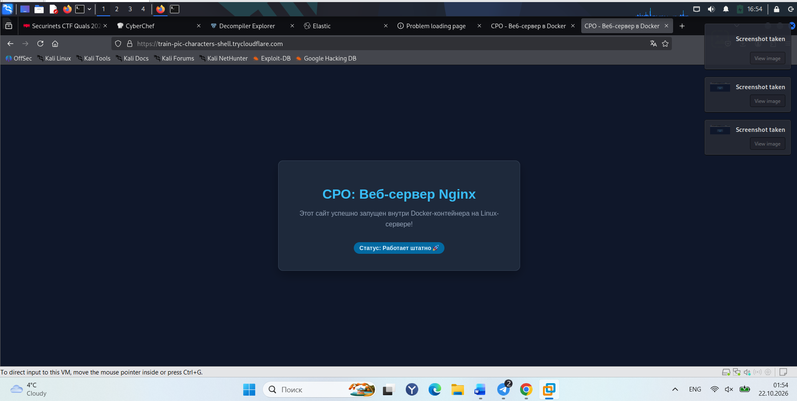

---

## 3️⃣ Глобальный хостинг в AWS S3

Amazon S3 умеет раздавать статические файлы (HTML/CSS/JS) как веб-сайт — без серверов и Docker.

### Шаги в веб-консоли AWS

| Шаг | Действие |
|-----|---------|
| 1 | **S3 → Create bucket**: имя `sro-my-cool-website-2026`, регион `ap-southeast-2` (Sydney). Имя бакета должно быть уникальным во всём AWS |
| 2 | Снять галочку **Block all public access** (иначе сайт никто не увидит) и включить **ACLs enabled** |
| 3 | **Upload** → `index.html` |
| 4 | Выделить файл → **Actions → Make public using ACL** |
| 5 | **Properties → Static website hosting → Edit → Enable**, Index document: `index.html` |
| 6 | Открыть **Bucket website endpoint** |

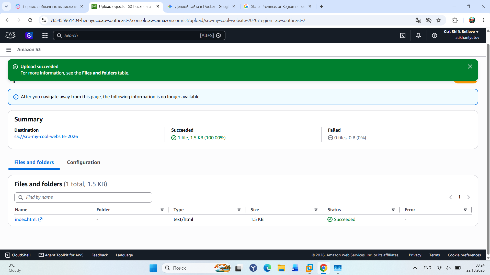
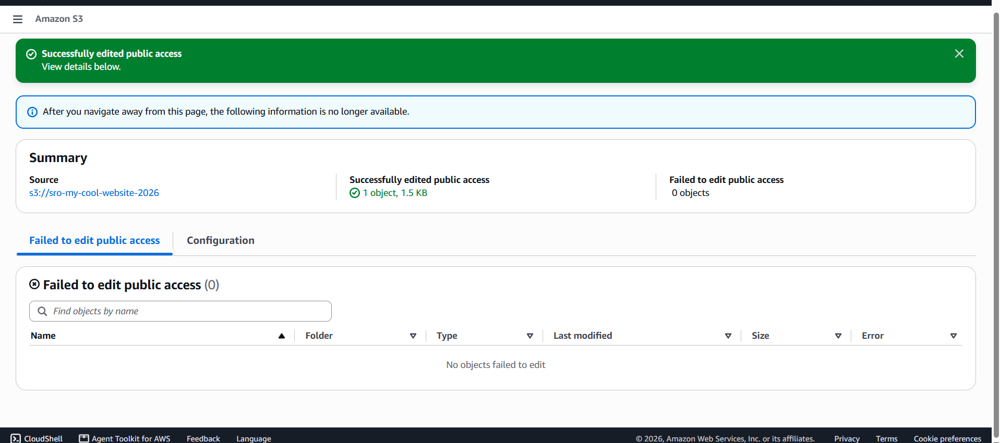

Static website hosting: до и после включения

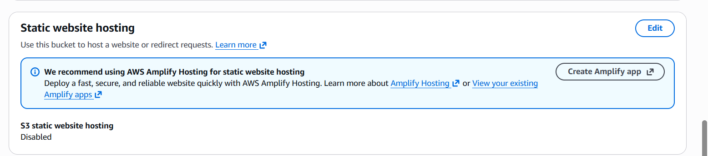
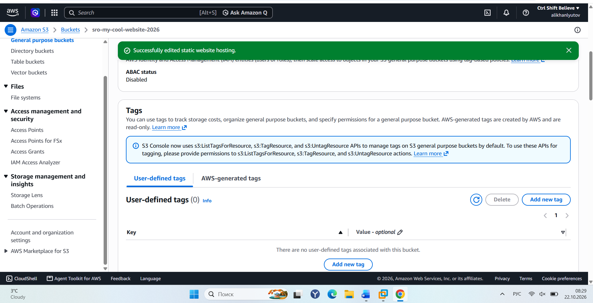
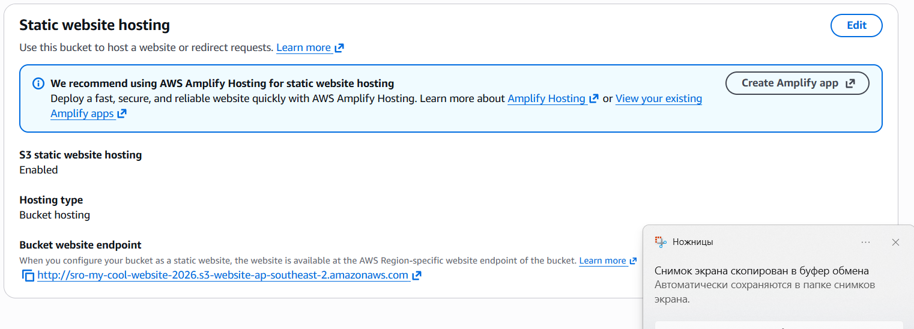

### Результат

`http://sro-my-cool-website-2026.s3-website-ap-southeast-2.amazonaws.com`

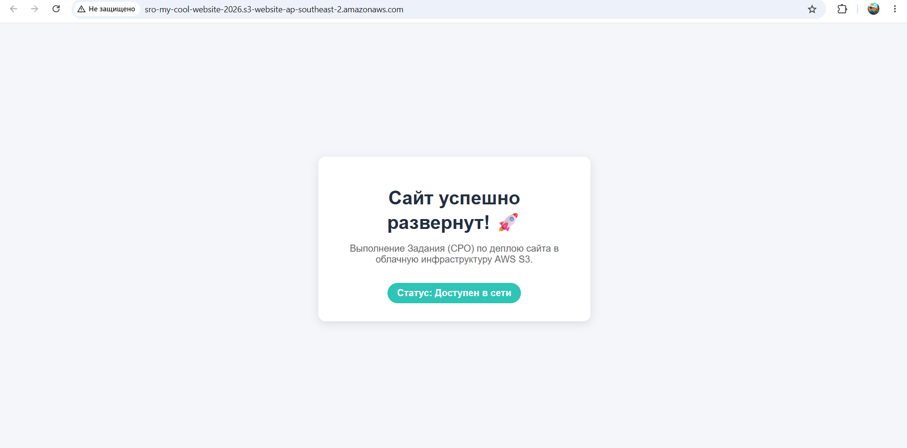

> Браузер пишет «Не защищено», потому что website-endpoint S3 работает только по HTTP. Для HTTPS перед бакетом ставят **CloudFront** с сертификатом.

### То же самое через AWS CLI

Вместо кликов в консоли можно выполнить `scripts/aws-deploy.sh`:

| Команда | Что делает |
|---------|-----------|
| `aws s3api create-bucket --bucket NAME --region REG --create-bucket-configuration LocationConstraint=REG` | создаёт бакет в нужном регионе |
| `aws s3api put-public-access-block ... =false` | снимает блокировку публичного доступа |
| `aws s3api put-bucket-policy --policy file://bucket-policy.json` | разрешает всем (`"Principal": "*"`) только чтение файлов (`s3:GetObject`) — альтернатива ACL на каждый файл |
| `aws s3 cp index.html s3://NAME/` | загружает файл |
| `aws s3 website s3://NAME/ --index-document index.html` | включает Static website hosting |

### Очистка ресурсов

После сдачи бакет был очищен и удалён, чтобы не тратить деньги:

1. **Empty** → ввести `permanently delete` → удалить все объекты
2. **Delete** → ввести имя бакета → удалить сам бакет (пустой)

CLI: `aws s3 rm s3://NAME --recursive && aws s3 rb s3://NAME` (`scripts/aws-cleanup.sh`).

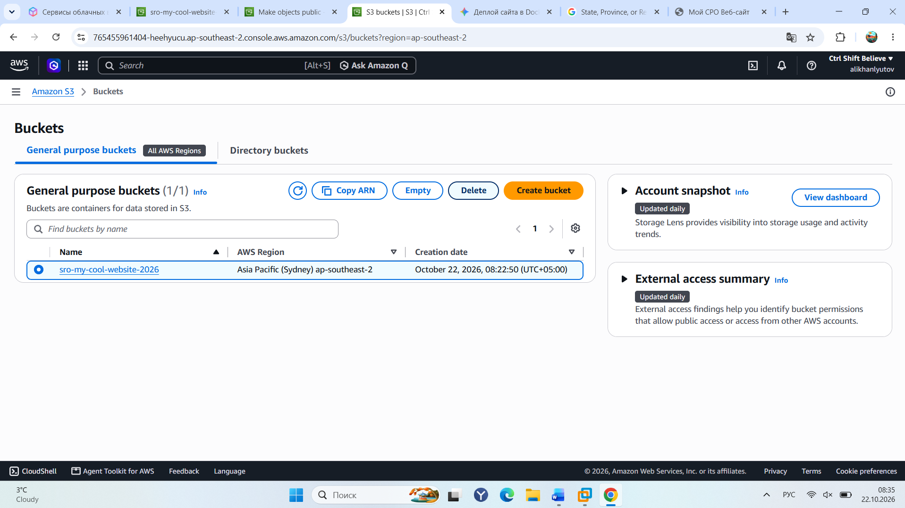
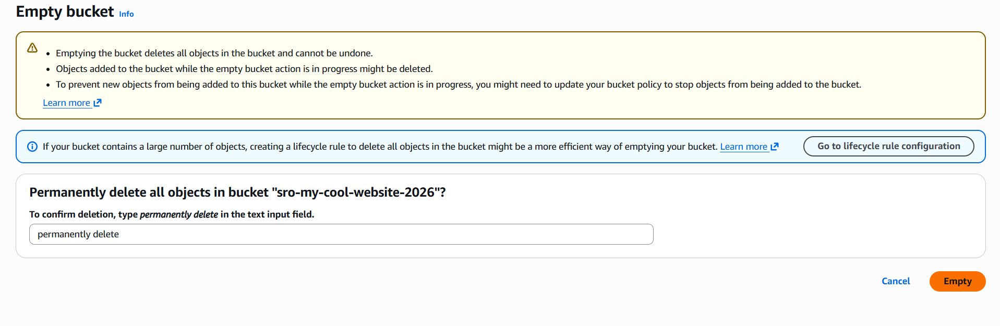
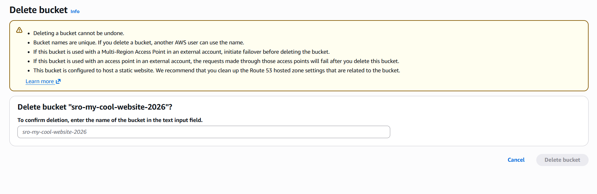
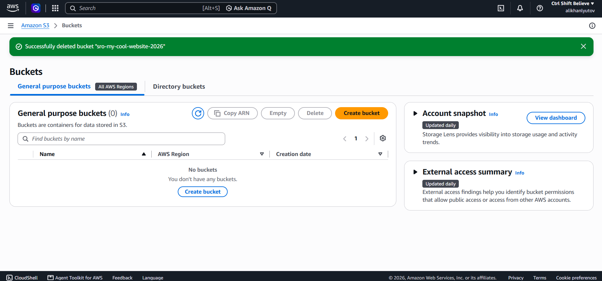

---

##  Сравнение способов

| | Docker (локально) | Cloudflare Tunnel | AWS S3 |
|---|---|---|---|
| Доступ из интернета | ❌ | ✅ | ✅ |
| HTTPS | ❌ | ✅ автоматически | ❌ (нужен CloudFront) |
| Нужен включённый компьютер | ✅ | ✅ | ❌ |
| Постоянный адрес | — | ❌ меняется при каждом запуске | ✅ |
| Динамика (бэкенд, БД) | ✅ | ✅ | ❌ только статика |
| Стоимость | бесплатно | бесплатно | Free Tier / копейки |

##  Стек

Kali Linux · Docker · Nginx (alpine) · Cloudflare Tunnel (`cloudflared`) · AWS S3 · AWS CLI
